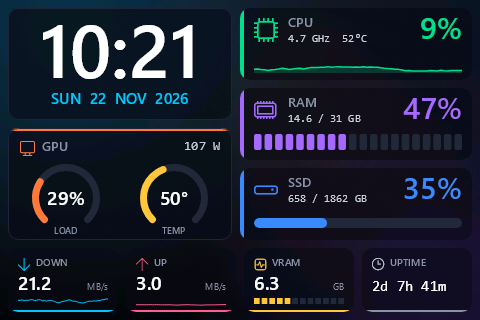
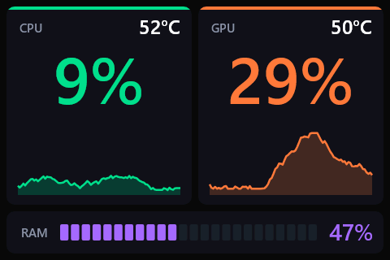

# sensor-panel

A Windows system monitor for the small USB screen on my desk, a Turing Smart Screen 3.5", written in C#. One self-contained exe sits in the notification area, reads hardware sensors, draws a dashboard described by a JSON file, and sends it to the panel over USB. Its right-click menu switches between layouts while it runs.

<table>
  <tr>
    <td align="center"><br><sub>The default dashboard (<code>default-sample.json</code>)</sub></td>
    <td align="center"><br><sub>Simple columns (<code>simple-columns.json</code>)</sub></td>
  </tr>
</table>

## Built for one PC

This is written and tuned on one machine:

| Part | Model |
|---|---|
| Display | Turing Smart Screen 3.5" (hardware revision A) |
| CPU | AMD Ryzen 7 9850X3D |
| Motherboard | Gigabyte X870 AORUS ELITE WIFI7 |
| GPU | NVIDIA GeForce RTX 5070 Ti |
| OS | Windows 11 |

It is shared as is. It will probably run on other Windows PCs with the same panel, but some things are fitted to the hardware above and will need editing on yours (sensor names, network and disk in the C# code, then a rebuild; layout ranges in the JSON configs):

- **The panel.** Only the 3.5" rev A is supported. Other Turing models and revisions use other protocols and resolutions. Yours is a rev A if its device instance path in Device Manager (Details tab) is `USB\VID_1A86&PID_5722\USB35INCHIPSV2`.
- **Sensor names.** The `Maps` table in [Sensors/SensorHub.cs](src/SensorPanel/Sensors/SensorHub.cs) looks sensors up by the names LibreHardwareMonitor gives them on this machine. The CPU lines have AMD and Intel fallbacks; the motherboard fan headers (`fan.cpu`, `fan.sys1`, `fan.sys2`) are a Gigabyte X870's names. None of the shipped layouts show `fan.*` or `cpu.power`, so a different board only matters once you add them.
- **The GPU.** An NVIDIA card is read through NVML, the monitoring library in NVIDIA's driver, which uses the first NVIDIA card. Other GPUs are read through LibreHardwareMonitor, which is untested here; with an AMD or Intel card plus an integrated GPU, pin the right one with `Device:` (see [Adding a key](docs/guide.md#adding-a-key)).
- **Network.** `net.*` reads the adapter named `Ethernet`: the `Device: "Ethernet"` text in `Maps`. Wi-Fi adapters are usually named `Wi-Fi`; `SensorPanel sensors` lists yours under Network.
- **Disk.** `disk.*` is drive `C:`, set by `new DriveInfo("C")` in `AddDerived()` in the same file. The default layout labels it SSD.
- **The layouts.** Ranges are set for this hardware: the VRAM bar tops out at 16 GB and the network graphs at 30 MB/s ([default-sample.json](src/SensorPanel/Configs/default-sample.json)), and the GPU temperature gauge and graph cover 20-90 °C ([default-sample.json](src/SensorPanel/Configs/default-sample.json), [portrait-sample.json](src/SensorPanel/Configs/portrait-sample.json)).

A key whose sensor is not found shows `--` in text and leaves bars, gauges and graphs empty, with no warning. Run `SensorPanel sensors` (elevated, see [Command line](docs/guide.md#command-line)) and check which keys are missing from "Keys available to widgets"; [Adding a key](docs/guide.md#adding-a-key) shows how to point a key at a different sensor.

## What it does

- **Sensors:** read with LibreHardwareMonitor, the open-source hardware-monitoring library. An NVIDIA GPU is read through NVML instead (see [settings.json](docs/guide.md#settingsjson)).
- **Layout:** six widget types drawn with SkiaSharp, bound to sensors by key name.
- **Tray:** a WinForms notification icon and menu.
- **Display:** only the pixels that changed are sent. Why, with measurements: [docs/transport-comparison.md](docs/transport-comparison.md).

Windows only. Five layouts ship inside the exe: the default dashboard ([default-sample.json](src/SensorPanel/Configs/default-sample.json)), a deliberately different portrait one ([portrait-sample.json](src/SensorPanel/Configs/portrait-sample.json)), a framed photo slideshow ([slideshow-sample.json](src/SensorPanel/Configs/slideshow-sample.json)) and two at-a-glance CPU, GPU and RAM monitors with big numbers and load graphs, as rows ([simple-rows.json](src/SensorPanel/Configs/simple-rows.json)) or columns ([simple-columns.json](src/SensorPanel/Configs/simple-columns.json)).

## Quick start

Requirements:

- **The panel**, plugged in. No driver is needed: Device Manager shows it under Ports as `USB Serial Device (COMx)`.
- **The PawnIO driver**, for CPU temperature, clock, power and fan sensors: `winget install namazso.PawnIO`
- **The .NET 10 SDK**, to build: `winget install Microsoft.DotNet.SDK.10`

There is no prebuilt download. Build the single exe, from the repository root:

```powershell
dotnet publish src/SensorPanel -r win-x64 --self-contained -p:PublishSingleFile=true
```

The result is `src\SensorPanel\bin\Release\net10.0-windows\win-x64\publish\SensorPanel.exe` (about 130 MB; it carries the .NET runtime and WinForms). Copy that one file anywhere and run it. Windows asks for administrator rights every time it starts (why, and how to avoid the prompt: [Getting every sensor](docs/guide.md#getting-every-sensor)). There is no window: look for the icon in the notification area, and right-click it to switch layouts. On first start the exe writes the shipped layouts into a `configs` folder beside itself; edit those or add your own.

Everything else is in [docs/guide.md](docs/guide.md): the tray menu, sensors that need administrator rights, the command line, `settings.json`, the config format, the sensor keys, and adding sensors and widget types.

## Not supported

Expressions in the config, plugins, hot reload, the theme formats of other Turing screen projects, panels other than the 3.5" rev A, and operating systems other than Windows.

## Credits

The wire protocol was learned by reading [turing-smart-screen-python](https://github.com/mathoudebine/turing-smart-screen-python) and [turing-smart-screen-custom-themes](https://github.com/thairc-dev/turing-smart-screen-custom-themes) (both GPL-3.0). No code or assets from either are included here.

## License

[MIT](LICENSE).
